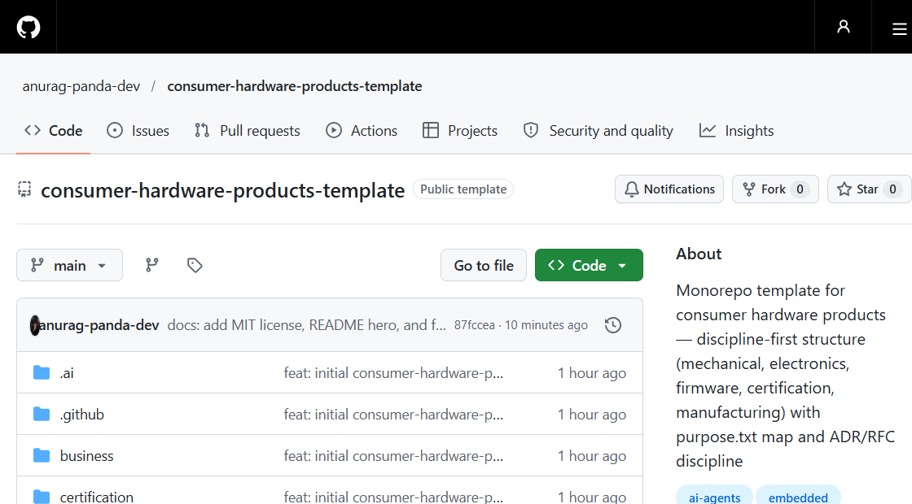

> 🌐 **English** · [বাংলা](README.bn.md)

> **Part of a template family** — use alongside
> [`big-software-product-template`](https://github.com/anurag-panda-dev/big-software-product-template) (software only) and
> [`full-stack-consumer-hardware-products-template`](https://github.com/anurag-panda-dev/full-stack-consumer-hardware-products-template) (hardware + software).

<h1 align="center">Consumer Hardware Products Template</h1>

<p align="center"><b>Every folder explains itself — to humans and to AI agents.</b><br>
100 <code>purpose.txt</code> maps · discipline-first layout · ADR/RFC decision discipline</p>

<p align="center">
  <a href="LICENSE"></a>
  <a href="https://github.com/anurag-panda-dev/consumer-hardware-products-template/generate"></a>
  <a href="https://github.com/anurag-panda-dev/consumer-hardware-products-template"></a>
</p>

<p align="center">
  
</p>

```text
products/         specs, variants, releases ── points INTO the disciplines below
mechanical/       CAD · enclosure · CMF
electronics/      PCB · power · RF
firmware/         bootloader · drivers · app · OTA agent
certification/    BIS · WPC · FCC · CE evidence
manufacturing/    DFM · assembly · jigs · yields
supply-chain/  validation/  packaging/  test-tools/
```

A monorepo template for developing **physical consumer products** — organized by *engineering discipline* (mechanical, electronics, firmware, certification, manufacturing), with `products/` holding per-line specs that point into them.

Structure rationale: `docs/decisions/ADR-0001-Structure.md`.

## Rules of thumb

| If it is… | It goes in… |
|---|---|
| A device product line's specs/variants/releases | `products/<line>/` |
| CAD, enclosure, CMF | `mechanical/` |
| Schematics, PCB, power, RF | `electronics/` |
| Bootloader, drivers, app firmware, OTA agent | `firmware/` |
| BIS/WPC/FCC/CE evidence | `certification/` |
| DFM, assembly, test jigs, quality, yields | `manufacturing/` |
| BOM, suppliers, costing | `supply-chain/` |
| Reliability/thermal/battery/drop testing | `validation/` (the hardware analog of software tests) |
| Dielines, inserts, labels | `packaging/` |
| Jig software, flash tools, calibration | `test-tools/` |
| Business & operations | `business/` |
| Code-adjacent legal | `legal/` |
| Knowledge / decisions | `docs/` (landed) · `rfcs/` (pending) |
| Prototype / research | `sandbox/` · `labs/` |

**Every folder contains a `purpose.txt`** — what belongs there and what it should hold. Keep them updated; they are the map.

## Structure

```text
products/         one folder per product line: product.md, requirements/, variants/, release/
mechanical/       cad, industrial-design, enclosure
electronics/      pcb, power, rf, devboards
firmware/         bootloader, drivers, application, boards, ota
certification/    india (BIS/WPC/TEC), international (FCC/CE), emc, safety, environment
manufacturing/    dfm, assembly, test-jigs, quality, yields
supply-chain/     bom, suppliers, costing
validation/       reliability, thermal, battery, drop-vibration, emc-prescan
packaging/        dieline, inserts, labels
test-tools/       jig firmware, flash tools, calibration
business/         product, market-research, marketing, pricing, monetization, finance, metrics, team, support
legal/            compliance, ip, licenses, templates
docs/             architecture, product, strategy, decisions (+ TEMPLATE.md)
rfcs/ labs/ sandbox/ tooling/ (scripts, exporters) security/ .ai/ AGENTS.md
```

## Boundary rules (see PACKAGE.md)

- `products/<line>/` holds **specs and pointers** — artifacts (CAD, gerbers, firmware) live in discipline folders and are linked from `product.md`.
- Generated outputs (exports from `tooling/exporters`: STEP/STL/Gerber/PDF) are **never hand-edited** — regenerate from source.
- `sandbox/` and `labs/` never feed production folders directly; graduation is an explicit, reviewed move.
- Corporate documents (equity, HR, signed contracts, IP filings) belong in a **private company-ops repo**, never here.

## Using this template

1. **Use this template** on GitHub (or `gh repo create my-project --template anurag-panda-dev/consumer-hardware-products-template`)
2. **Rename** — update root `README.md`, `purpose.txt`, `AGENTS.md`
3. **Replace `products/example-device/`** with your real product line (keep the layout: `product.md`, `requirements/`, `variants/`, `release/`)
4. **Record your first decision** — copy `docs/decisions/TEMPLATE.md` → `ADR-0001-…`; big choices (MCU platform, enclosure material, CM partner) go through `rfcs/` first
5. **Do not pre-create empty scaffolding** — folders fill as real work arrives
6. Add CI gradually in `.github/workflows/` (KiCad DRC, firmware build, BOM lint are listed in its `purpose.txt`)
